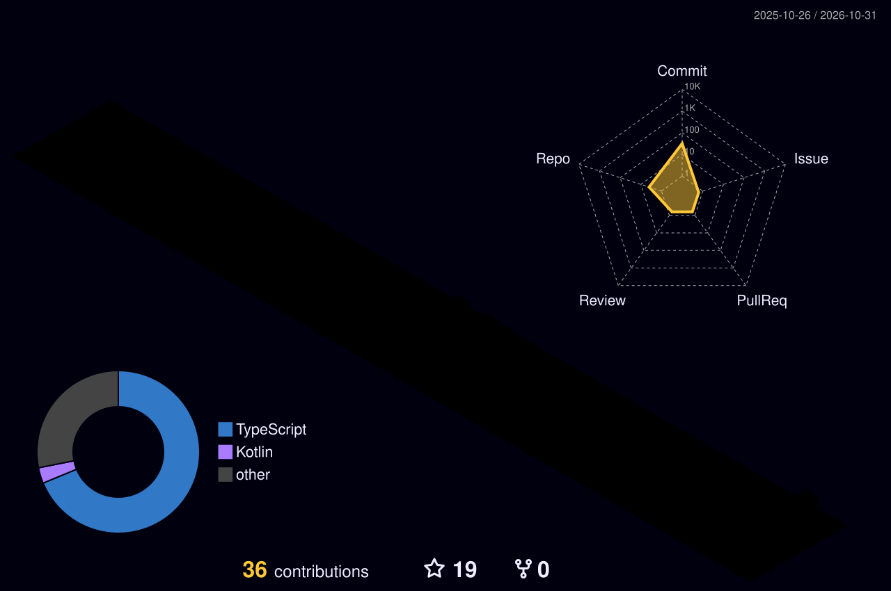

<!-- ════════════════════════════════════════════════════════════════
     HERO — custom animated isometric banner (assets/hero.svg)
     ════════════════════════════════════════════════════════════════ -->
<a href="https://github.com/SirBento">
  
</a>

<div align="center">

<a href="https://git.io/typing-svg">
  
</a>

<br/>

<a href="https://www.linkedin.com/in/bernard-towindo-117639193/"></a>
<a href="https://twitter.com/bernardtowindo"></a>
<a href="https://stackoverflow.com/users/11777737/bernard-towindo"></a>
<a href="https://www.instagram.com/bento_38/"></a>
<a href="https://www.facebook.com/bernard.towindo.9/"></a>
<a href="mailto:bernardtowindo38@gmail.com"></a>
<a href="https://www.wefiscalise.com"></a>


</div>

<br/>

<!-- ════════════════════════════════════════════════════════════════
     ABOUT
     ════════════════════════════════════════════════════════════════ -->
<h2 align="left">
   About Me
</h2>

<table>
<tr>
<td width="58%" valign="top">

```kotlin
object Bernard : SoftwareEngineer {
    override val location   = "Harare, Zimbabwe 🇿🇼"
    override val focus      = listOf("Full-Stack", "Cloud", "Mobile")
    override val building   = mapOf(
        "WeFiscalise"   to "ZIMRA FDMS fiscalisation SaaS",
        "HutchHub"      to "Rabbit farm management",
        "Smart Parking" to "IoT slot tracking",
    )
    override val learning   = listOf("AWS SA", "Kubernetes", "Kafka")
    override val philosophy = """
        Clean architecture over clever hacks.
        Microservices when they make sense.
        Ship fast, iterate faster.
    """.trimIndent()

    fun funFact() = "I think I'm funny 😄 — my compiler disagrees."
}
```

</td>
<td width="42%" valign="top">

**🔭 Right now**
- Shipping **WeFiscalise** — real-time ZIMRA fiscalisation across web, desktop, Android & POS
- Designing offline-first, store-and-forward pipelines

**🤝 Open to**
- Freelance / contract work
- Technical co-founder roles
- Open-source collaboration
- Mentorship & tech talks

**💬 Ask me about**
`Java` `Spring Boot` `Kotlin` `TypeScript` `React` `React Native` `Microservices` `System Design` `GCP` `AWS` `Docker`

</td>
</tr>
</table>

<!-- ════════════════════════════════════════════════════════════════
     FEATURED PROJECTS
     ════════════════════════════════════════════════════════════════ -->
<h2>🚀 Featured Projects</h2>

<table>
<tr>
<td width="33%" valign="top">

### 💰 [WeFiscalise](https://www.wefiscalise.com)


Zimbabwe's 100% cloud-based **ZIMRA FDMS** VAT compliance platform. Real-time fiscalisation, e-invoicing, automated fiscal days, POS and multi-branch management — **no hardware required**.

<sub>`Spring Boot` `React` `Capacitor` `Electron` `GCP Cloud Run`</sub>

</td>
<td width="33%" valign="top">

### 🐇 [HutchHub](https://github.com/SirBento/HutchHub)


A dedicated rabbit farm management platform. Track hutches, breeds, health records, feeding schedules and farm analytics — built for Zimbabwean farmers.

<sub>`React Native` `Spring Boot` `MySQL`</sub>

</td>
<td width="33%" valign="top">

### 🚗 [Smart Parking](https://github.com/SirBento/Smart-Parking)


Intelligent parking management with real-time slot tracking and automated entry/exit control, from sensor to dashboard.

<sub>`Java` `IoT` `Arduino`</sub>

</td>
</tr>
</table>

<!-- ════════════════════════════════════════════════════════════════
     TECH STACK
     ════════════════════════════════════════════════════════════════ -->
<h2>🛠️ Tech Stack</h2>

<div align="center">

<table>
<tr>
<td align="center" width="140"><b>Languages</b></td>
<td></td>
</tr>
<tr>
<td align="center"><b>Frontend<br/>& Mobile</b></td>
<td></td>
</tr>
<tr>
<td align="center"><b>Backend</b></td>
<td></td>
</tr>
<tr>
<td align="center"><b>Data</b></td>
<td></td>
</tr>
<tr>
<td align="center"><b>Cloud<br/>& DevOps</b></td>
<td></td>
</tr>
<tr>
<td align="center"><b>Messaging<br/>& Tools</b></td>
<td></td>
</tr>
</table>

</div>

<!-- ════════════════════════════════════════════════════════════════
     3D CONTRIBUTIONS (generated daily by .github/workflows/profile-3d.yml)
     ════════════════════════════════════════════════════════════════ -->
<h2>🧊 Contributions in 3D</h2>

<div align="center">
<picture>
  <source media="(prefers-color-scheme: dark)" srcset="./profile-3d-contrib/profile-night-rainbow.svg" />
  <source media="(prefers-color-scheme: light)" srcset="./profile-3d-contrib/profile-green-animate.svg" />
  
</picture>
</div>

<!-- ════════════════════════════════════════════════════════════════
     STATS
     ════════════════════════════════════════════════════════════════ -->
<h2>📊 GitHub Stats</h2>

<div align="center">


<br/><br/>


</div>

<!-- ════════════════════════════════════════════════════════════════
     SNAKE (generated daily by .github/workflows/snake.yml → output branch)
     ════════════════════════════════════════════════════════════════ -->
<h2>🐍 Eating My Commits</h2>

<div align="center">
<picture>
  <source media="(prefers-color-scheme: dark)" srcset="https://raw.githubusercontent.com/SirBento/SirBento/output/github-snake-dark.svg" />
  <source media="(prefers-color-scheme: light)" srcset="https://raw.githubusercontent.com/SirBento/SirBento/output/github-snake.svg" />
  
</picture>
</div>

<!-- ════════════════════════════════════════════════════════════════
     MISSION + FOOTER
     ════════════════════════════════════════════════════════════════ -->
<h2>🌍 Building from Zimbabwe</h2>

> I use technology to solve real African problems — from ZIMRA tax compliance automation to agricultural management.
> If you're building something that matters, **let's talk.**

<div align="center">

<br/>

<i>"First, solve the problem. Then, write the code."</i>

<br/><br/>

<a href="mailto:bernardtowindo38@gmail.com">
  
</a>

</div>


